<div align="center">
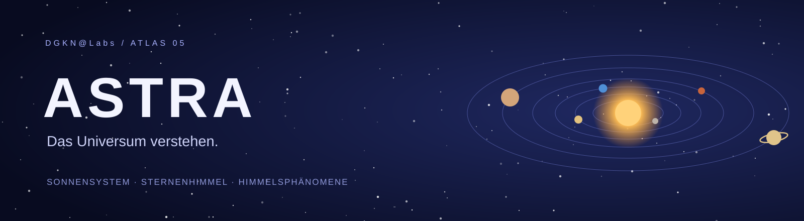

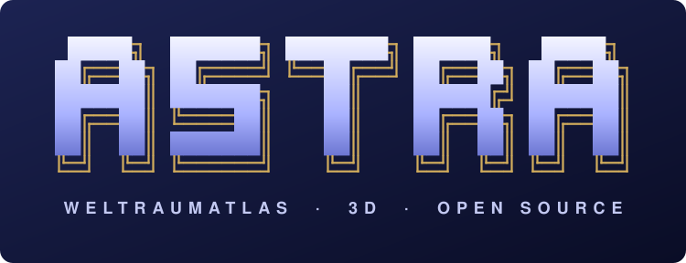

<details>
<summary>Originales ASCII-Logo zum Kopieren</summary>

```text
 █████╗  ███████╗ ████████╗ ██████╗   █████╗
██╔══██╗ ██╔════╝ ╚══██╔══╝ ██╔══██╗ ██╔══██╗
███████║ ███████╗    ██║    ██████╔╝ ███████║
██╔══██║ ╚════██║    ██║    ██╔══██╗ ██╔══██║
██║  ██║ ███████║    ██║    ██║  ██║ ██║  ██║
╚═╝  ╚═╝ ╚══════╝    ╚═╝    ╚═╝  ╚═╝ ╚═╝  ╚═╝
W E L T R A U M A T L A S  ·  3 D  ·  O P E N  S O U R C E
```

</details>

**Von der Sonne bis zu den Sternen über deinem Ort.**  
Ein interaktiver Weltraum-Atlas auf Deutsch — direkt im Browser.


**[Starten](#starten) · [Entdecken](#drei-perspektiven-auf-das-all) · [Screenshots](#echte-einblicke) · [Quellen](NOTICE.md)**
</div>

## Das All wird greifbar

ASTRA ist der fünfte Atlas von **DGKN@Labs**, nach [CORPUS](https://github.com/dogenc/CORPUS-Anatomieatlas), [CELLULA](https://github.com/dogenc/CELLULA), [TERRA](https://github.com/dogenc/TERRA) und [ELEMENTA](https://github.com/dogenc/ELEMENTA). Die Familie wandert damit durch alle Größenordnungen: vom Atom über Zelle, Körper und Erde bis ins Sonnensystem.

**Kein Build. Kein API-Key. Kein Konto.** Three.js, Texturen, Sternkatalog und alle Daten liegen im Repository. Die laufende App braucht keine Internetverbindung; Quellenlinks führen nach außen.

## Drei Perspektiven auf das All

| Bereich | Entdecken |
|---|---|
| **Sonnensystem** | Alle acht Planeten auf angenäherten Bahnen für jedes Datum von 1800 bis 2050 – mit Zeitregler, kompakter oder maßstäblicher Ansicht und aktuellen Abständen (Erde–Mars, Lichtlaufzeit …). |
| **Himmelskörper** | Sonne, Planeten und Mond als texturierte 3D-Kugeln; Pluto als schematische Kugel mit Achsneigung, Saturnringen und Wolken. Ein Klick auf **Innerer Aufbau** schneidet sie auf: Kern, Mantel, Kruste oder metallischer Wasserstoff. Steckbriefe mit NASA-Daten. |
| **Sternenhimmel** | Der Himmel über deinem Ort zu jeder Uhrzeit: 5.080 Sterne bis 6,0 mag, alle 88 Sternbilder mit deutschen Namen, Sonne, Mond und Planeten an ihrer berechneten Position. Mondphase, Dämmerung und Planeten über dem Horizont auf einen Blick. |
| **Phänomene** | Mondphasen, Sonnen- und Mondfinsternis, Jahreszeiten und das Leben eines Sterns – je vier Schritte mit Zeitleiste, Pause und Tempo. |

### Wie genau ist das?

Die Planetenpositionen stammen aus den Keplerschen Bahnelementen des **JPL** (E. M. Standish, gültig 1800–2050). Der Test `tests/data.mjs` vergleicht sie mit **JPL Horizons**: An den hinterlegten Referenzterminen liegt die größte Richtungsabweichung bei **0,14°** (Saturn), bei den inneren Planeten unter 0,01°. Der Mond wird mit einer verkürzten Störungsreihe berechnet und weicht an den Referenzterminen weniger als **0,05°** ab. Diese Stichproben belegen keine durchgehend gleiche Genauigkeit von 1800 bis 2050. Präzession, Nutation, Refraktion und topozentrische Mondparallaxe sind im Himmelsmodell nicht berücksichtigt; ASTRA dient der Veranschaulichung, nicht der Navigation.

### Werkzeuge zum Lernen

- **Drehen und zoomen** mit Maus oder Touch, Kamera zurücksetzen, automatische Rotation.
- **Zeit laufen lassen** – im Sonnensystem bis zu einem Jahr pro Sekunde, am Himmel bis zu sechs Stunden pro Sekunde.
- **Ort wählen:** elf Städte (einschließlich Dortmund) in Deutschland, Österreich, der Schweiz und der Türkei oder eigene Koordinaten.
- **Planeten anklicken** öffnet ihren Steckbrief.
- **PNG-Export** der aktuellen Ansicht.
- **Notizen pro Eintrag**, ausschließlich im lokalen Browser-Speicher.
- **Direktlinks**, beispielsweise `#body/saturn`, `#sky/Ori`, `#process/eclipse`.
- **Tastatur:** Tab navigiert, Leertaste startet/pausiert Zeit oder Ablauf, R setzt die Kamera zurück.

## Echte Einblicke

Acht echte Aufnahmen aus ASTRA 1.0.0 mit **1800 × 1160 Pixeln**, dazu eine Handyansicht. Keine Mockups.

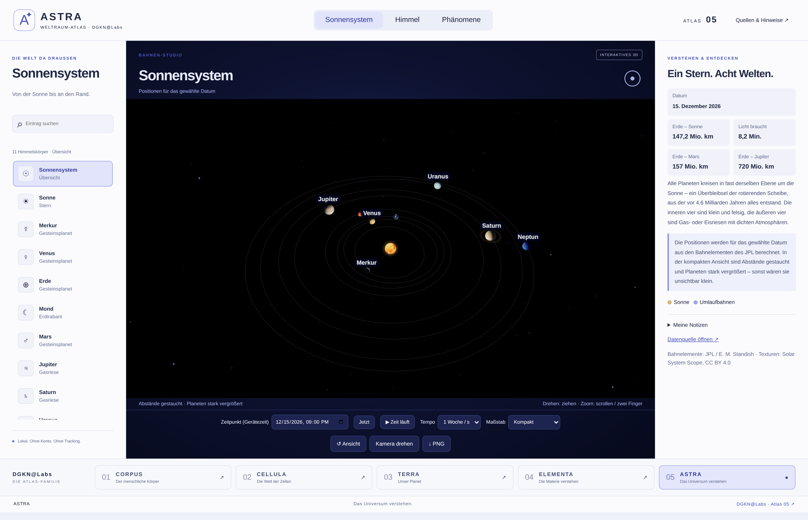

| Erde · Innerer Aufbau | Saturn |
|---|---|
| 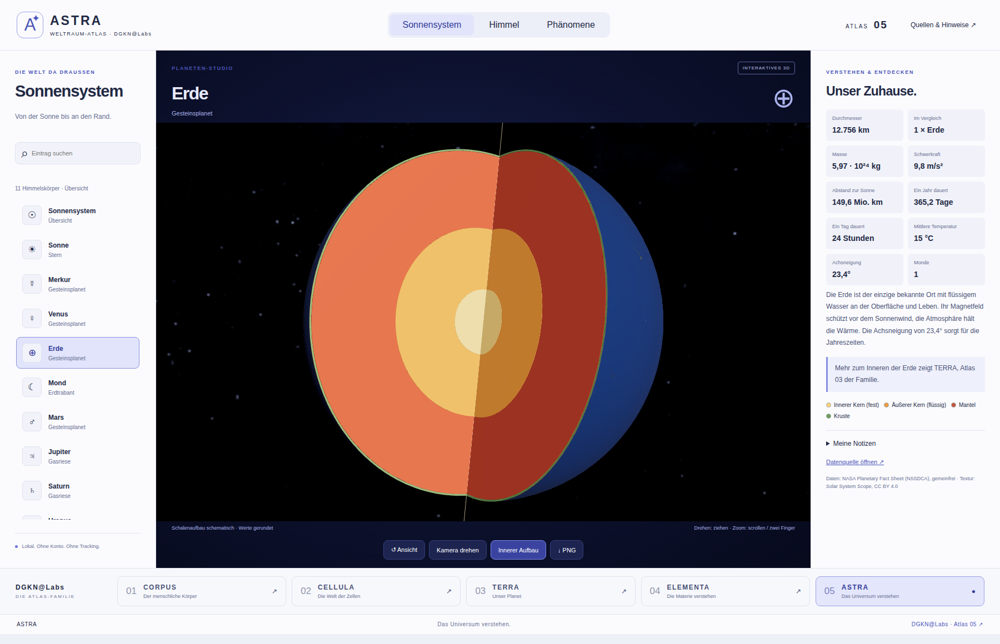 | 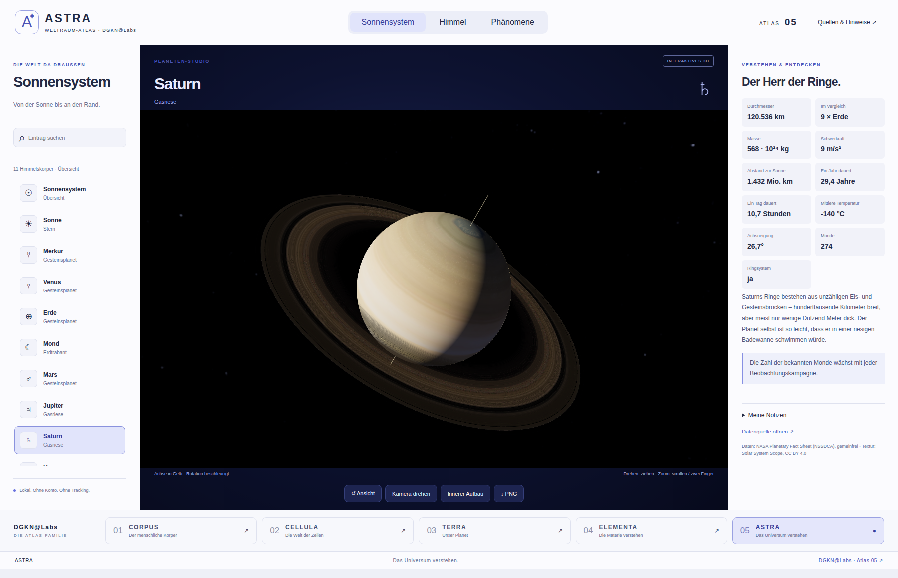 |

| Himmel über Berlin | Sternbild Orion |
|---|---|
| 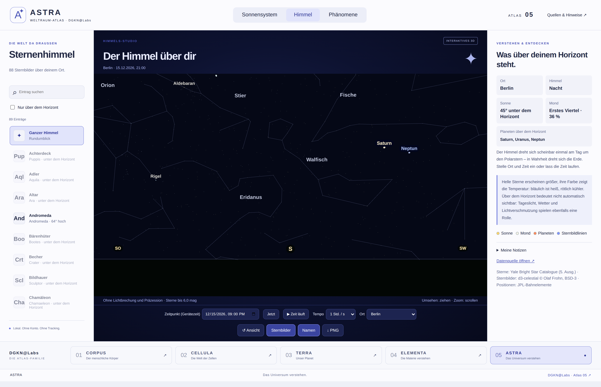 | 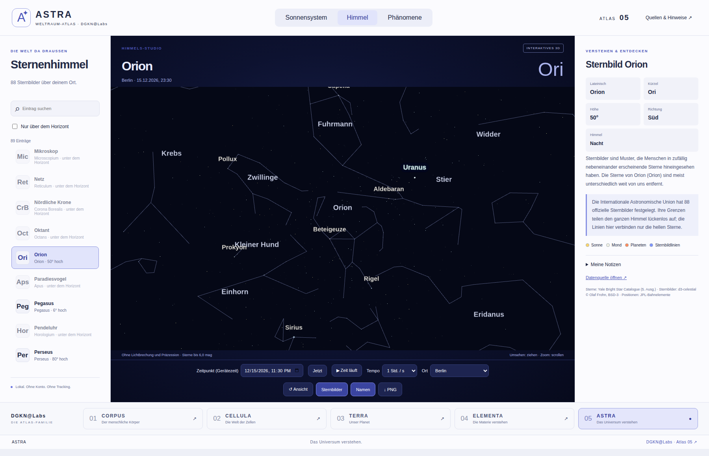 |

| Mondphasen | Mondfinsternis |
|---|---|
| 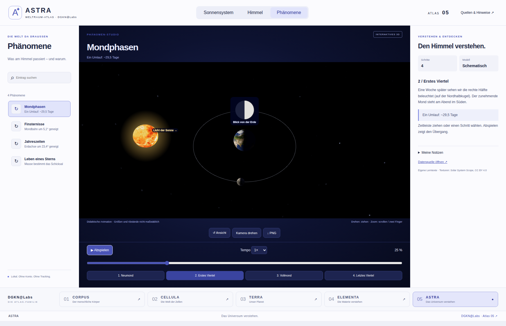 | 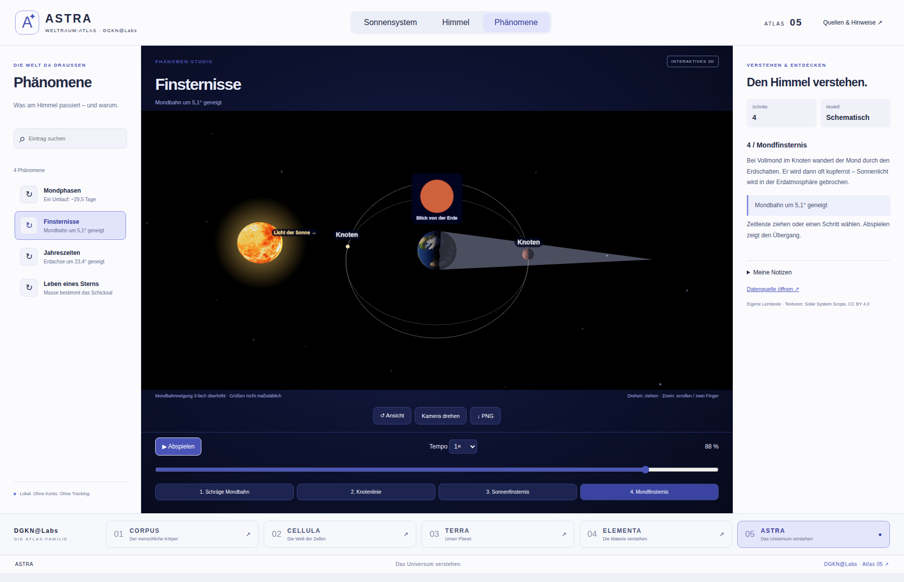 |

| Leben eines Sterns | Auf dem Smartphone |
|---|---|
| 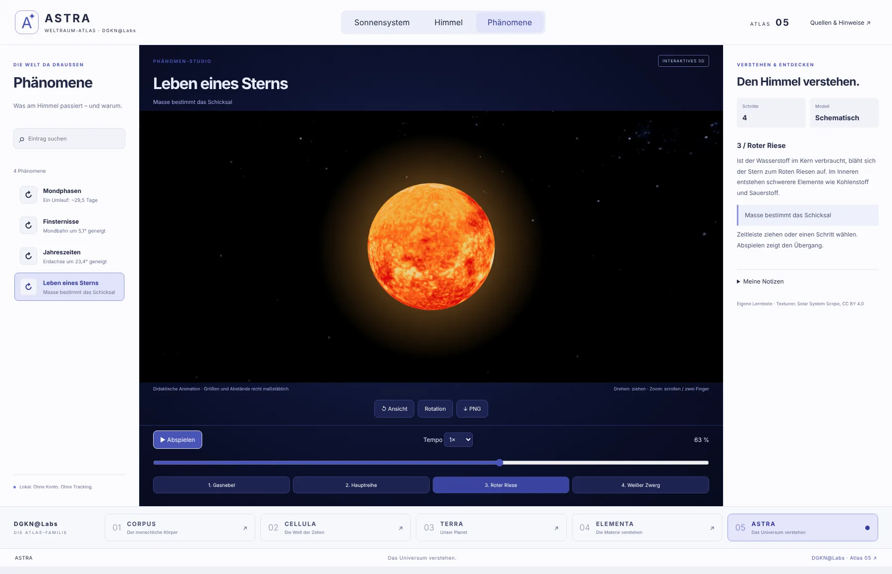 | 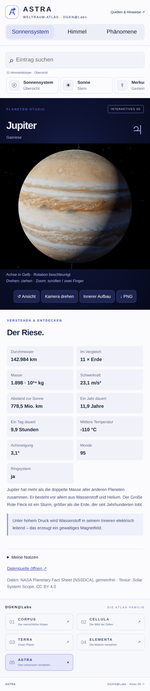 |

## Starten

Voraussetzung: **Python 3** und ein moderner Browser mit WebGL2.

```bash
git clone https://github.com/dogenc/ASTRA.git
cd ASTRA
python3 start.py
```

Öffnet **http://127.0.0.1:8769**. Unter Windows: `START_WINDOWS.cmd` doppelklicken (Python muss installiert sein). Beenden mit Strg+C.

Die HTML-Datei braucht einen HTTP-Server; `file://` unterstützt das Laden der Module und JSON-Daten nicht zuverlässig.

### Auf der eigenen Domain

Den Inhalt von **`dist/`** als Website ausliefern — beispielsweise mit Cloudflare Pages oder einem eigenen Webserver.

| Einstellung | Wert |
|---|---|
| Build-Befehl | leer lassen |
| Ausgabeverzeichnis | `dist` |
| Backend / Umgebungsvariablen | keine |

## Desktop-Downloads

**[Windows & macOS herunterladen →](https://github.com/dogenc/ASTRA/releases/latest)** · [Build-Status ansehen](https://github.com/dogenc/ASTRA/actions/workflows/desktop.yml)

| Paket | Verwendung |
|---|---|
| `ASTRA-1.0.1-Windows-Setup.exe` | Installierbare Windows-App, x64 |
| `ASTRA-1.0.1-Windows-portable.exe` | Ohne Installation starten, x64 |
| `ASTRA-1.0.1-macOS.dmg` | macOS-App für Intel und Apple Silicon |
| `ASTRA-1.0.1-Web.zip` | Statische Dateien für die eigene Domain |
| `SHA256SUMS.txt` | Prüfsummen der Downloads |

Der Workflow veröffentlicht diese Dateien **erst nach erfolgreichen Daten-, Browser- und nativen Desktop-Prüfungen**. Die Pakete sind ohne kommerzielles Herausgeberzertifikat; macOS ist nicht notarisiert. Das Betriebssystem kann deshalb Warnungen anzeigen.

Für Entwickler:

```bash
# Im Repository-Hauptordner:
npm ci
npm test
npx playwright install chromium
node tests/browser.cjs
node scripts/gallery.cjs
python3 scripts/prepare_data.py  # Optional: Daten aus sources/ neu aufbereiten

# Desktop-App starten:
cd desktop
npm ci
npm start
```

## Technik und Bearbeitung

Die Website läuft mit **HTML, CSS, JavaScript und Three.js 0.180.0** ohne Bundler. Electron verpackt dieselben lokalen Dateien für Windows und macOS; Python dient nur dem lokalen Webserver und der Datenaufbereitung.

| Dateien | Aufgabe |
|---|---|
| `dist/index.html`, `dist/style.css` | Oberfläche, mobile Darstellung, Atlas-Navigation |
| `dist/app.js` | Auswahl, Datum, Ort, Lernpanels und Notizen |
| `dist/astro.js` | Bahnelemente, Koordinaten, Schalenaufbau und Lerntexte |
| `dist/studio.js` | Three.js-Szenen, Kamera, Animationen und PNG-Export |
| `dist/data/`, `dist/tex/`, `dist/vendor/` | Lokale Daten, Texturen und Bibliotheken |
| `sources/`, `scripts/prepare_data.py` | Hinterlegte Originaldaten und Aufbereitung |
| `scripts/gallery.cjs`, `docs/gallery/` | Echte Aufnahmen aus der laufenden App |
| `desktop/` | Electron-App und Installer-Konfiguration |
| `tests/`, `.github/workflows/desktop.yml` | Daten-, Geometrie-, Browser- und native Prüfungen |

## Die Atlas-Familie

| Atlas | Thema |
|---|---|
| 01 · [CORPUS](https://github.com/dogenc/CORPUS-Anatomieatlas) | Der menschliche Körper |
| 02 · [CELLULA](https://github.com/dogenc/CELLULA) | Die Welt der Zellen |
| 03 · [TERRA](https://github.com/dogenc/TERRA) | Unser Planet |
| 04 · [ELEMENTA](https://github.com/dogenc/ELEMENTA) | Die Materie verstehen |
| **05 · ASTRA** | **Das Universum verstehen** |

## Qualitätsprüfung 1.0.1

`npm test` prüft zusätzlich die echte Three.js-Geometrie: Ausrichtung der Erdachse zu allen vier Jahreszeiten, Schattenrichtung, Mondphasen, die Übersicht aller acht Planeten, erhaltene Himmelsansicht und Zoom, Horizontbeschriftungen sowie die rückläufige Rotation von Venus und Uranus. Der Browser-Test prüft außerdem Zeitgrenzen, Ortseingaben, blockierten lokalen Speicher und Bedienung mit der Tastatur. Neue Screenshots entstehen direkt aus der App im Actions-Lauf.

[Prüfprotokoll](docs/TESTING.md) · [Actions](https://github.com/dogenc/ASTRA/actions/workflows/desktop.yml)

## Quellen & Lizenz

Programmcode und eigene Lerntexte: **MIT** ([LICENSE](LICENSE)). Planetentexturen: [Solar System Scope](https://www.solarsystemscope.com/textures/), **CC BY 4.0**. Sterne: Yale Bright Star Catalogue. Sternbilder: [d3-celestial](https://github.com/ofrohn/d3-celestial) © Olaf Frohn, **BSD-3-Clause**. Bahn- und Körperdaten: NASA / JPL, gemeinfrei. ASTRA ist kein Produkt der NASA oder des JPL. Alle Details, Modellgrenzen und Abrufdaten: **[NOTICE.md](NOTICE.md)**.

Die Lerntexte sind KI-unterstützt erstellt; eine unabhängige fachredaktionelle Abnahme steht aus.

---

<div align="center">
<br>


**Große Fragen beginnen mit einem Blick nach oben.**<br>
<sub>ASTRA · DGKN@Labs · Atlas 05</sub><br>
<sub>[CORPUS · Der Körper](https://github.com/dogenc/CORPUS-Anatomieatlas) &nbsp; / &nbsp; [CELLULA · Die Zelle](https://github.com/dogenc/CELLULA) &nbsp; / &nbsp; [TERRA · Die Erde](https://github.com/dogenc/TERRA) &nbsp; / &nbsp; [ELEMENTA · Die Materie](https://github.com/dogenc/ELEMENTA) &nbsp; / &nbsp; <b>ASTRA · Das Universum</b></sub>

</div>
